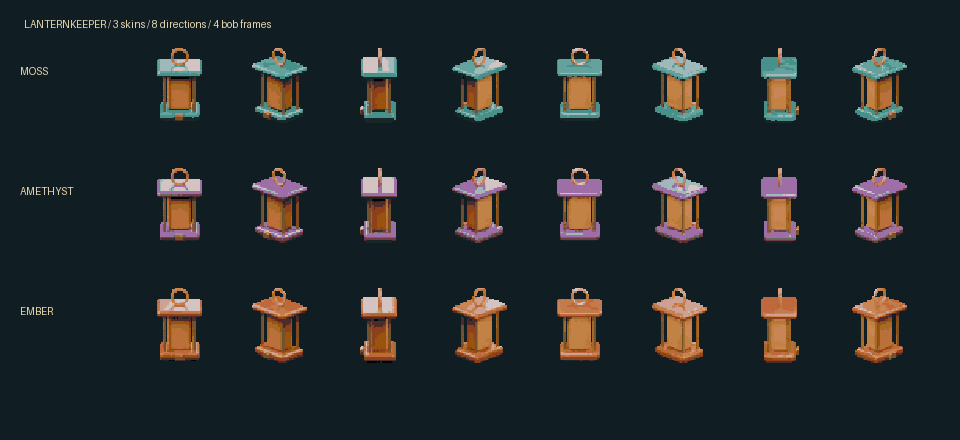
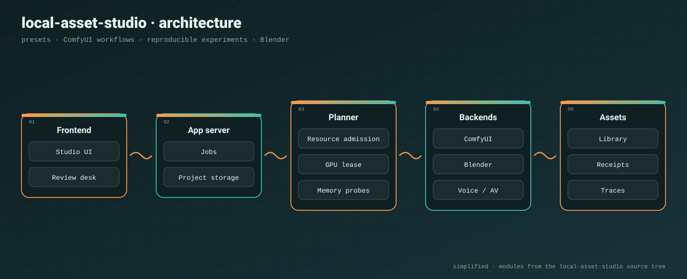
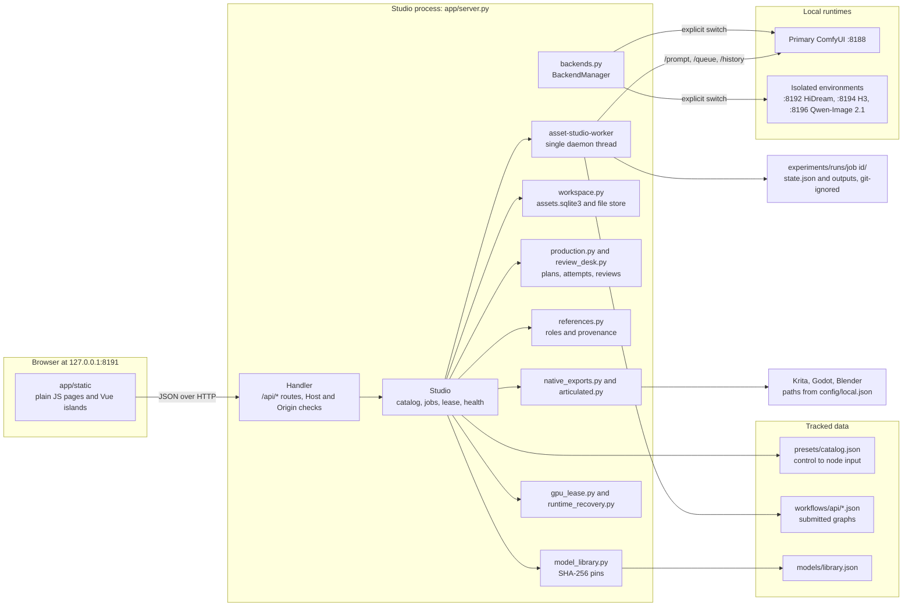

# Local Asset Studio

<p align="center"></p>

**A local-first studio on top of ComfyUI that keeps each generated asset tied to the recipe, references and evidence that produced it.**

[](https://github.com/Chris0Jeky/local-asset-studio/actions/workflows/check.yml)

-339933?logo=nodedotjs&logoColor=white)



[Start here](docs/START-HERE.md) ·
[Product direction](docs/PRODUCT_DIRECTION.md) ·
[Status](docs/STATUS.md) ·
[Operations](docs/OPERATIONS.md) ·
[Documentation index](docs/README.md)

## What it is

Local Asset Studio is a Python web app that runs on one Windows PC next to a local ComfyUI install. It puts goal-led routes (pick a result, add references, see the planned route, generate) in front of ComfyUI's node graph, and it keeps the graph underneath visible. Each job stores the exact graph it submitted, the settings and reference roles, output hashes, and a record of what the run did and did not prove.

It is a personal tool. The server binds to `127.0.0.1:8191` only, it has no accounts, and it is not a hosted generation service. Models, ComfyUI, and generated outputs live outside Git.

## Why it exists

ComfyUI is flexible, and that flexibility makes results easy to lose. A graph that made a good picture last week is hard to rebuild from memory, and a run that finished says nothing about whether the hand is right or whether the LoRA's licence allows the use.

The Studio keeps three states apart on purpose:

- **Generated:** the job completed and its outputs were recorded.
- **Inspected or accepted:** a person judged the result. An agent's judgement is not acceptance.
- **Licensed:** the model and LoRA terms allow the use. Matching hashes do not prove that.

Agents can plan, compare and inspect work through the same surfaces. They cannot download, install, generate, publish or accept output on their own.

## Features

Everything below exists in the code. Where a feature is only partly proven, the Status section says so.

### Guided creation

- **92 presets** in `presets/catalog.json` across pixel art, product and website art, game props, anime and fantasy characters, manga line art and screentone, FLUX.2 Klein, Qwen and Qwen-Image 2.1, Z-Image, Krea 2, Anima, WAI, Animagine, Pony, NoobAI, HiDream O1, MiniMax H3, Wan 2.2, TRELLIS.2 and Hunyuan3D 2.1.
- Each preset carries a `verified` flag. `true` means a Studio job for that route completed and was inspected. It is not art acceptance.
- Prompt wildcards, LoRA slots, seed reuse and saved output metadata.
- Explicit switches between local environments: the primary ComfyUI on `8188` and three isolated ones on `8192` (HiDream O1), `8194` (MiniMax H3) and `8196` (Qwen-Image 2.1). Switches never upgrade packages.
- Before a checkpoint change, the Studio unloads the previous model from ComfyUI's GPU memory. An idle model cache is released after a configurable number of minutes.
- Owner cancel for a Create job (`POST /api/jobs/<id>/cancel`). A job that has not been sent is removed. A prompt waiting in ComfyUI's queue is deleted, and a running one is interrupted. Nothing is resubmitted.
- An uncertain submission is recorded as uncertain and is not resubmitted automatically. See [Operations](docs/OPERATIONS.md).

### References and poses

- Reference roles (identity, pose, style, outfit, composition, source) with byte-level provenance in `app/references.py`.
- Combine routes that put a character into another picture's pose, using a drawn pose skeleton, a depth map, or a Copy Pose stage (`combine-klein-9b-*`, `wai-skeleton`).
- Qwen Atelier presets for one, two or three references (`qwen-1ref` to `qwen-3ref`).
- A pose editor that renders a COCO-18 drawn pose into a stored guide picture (`app/pose_guide.py`). The module never calls ComfyUI.
- Targeted edits (`flux-edit`), masked repair (`anime-masked-repair`), seam repair for seamless tiles (`zimage-seam-repair`), and parallax layers split from an accepted still (`parallax-edit`).

### Experiments and evidence

- Durable comparison plans with budgeted attempts (`app/production.py`), including a plan that runs one Combine pair across several engines with the same seeds (`app/combine_plan.py`).
- Revisioned review of comparisons in Production's SQLite database (`app/review_desk.py`).
- Settings sweeps built from the settings knowledge base, with each variant sourced (`app/settings_planner.py`).
- Read-only resource observations and receipts (`app/resource_probe.py`, `app/resource_receipts.py`) that record VRAM and commit figures where the host can report them.
- Failed, partial and inconclusive trials stay in the record. They are not filtered into a winners-only view.

### Workspace and native finishing

- An asset workspace in SQLite (`assets.sqlite3`) with a content-addressed file store, favourites, tags, notes, collections and reversible trash (`app/workspace.py`).
- Krita OpenRaster round trip through a fixed, non-interactive adapter (`scripts/krita_roundtrip.py`).
- Godot packages: sprite atlases and GLBs, verified by an explicitly selected Godot (`scripts/godot_asset_adapter.py`). The package step does not execute user code.
- A Blender-authored articulated chest study through a fixed Blender script (`scripts/articulated_prop.py`).
- 3D drafts from TRELLIS.2 and Hunyuan3D 2.1 produce GLB meshes. These are geometry only. UVs, materials, cleanup and rigging are finishing work.
- Versioned AV projects with CPU rendering through ffmpeg (`studio_av/`, `scripts/studio_av.py`).
- Spoken Briefs: one Markdown handoff becomes a narration WAV over the pinned Kokoro CPU baseline (`scripts/spoken_brief.py`). See Status for what has and has not been proven.

### Models and runtime safety

- A checksum-pinned model inventory in `models/library.json`, with SHA-256 pins and explicit installers (`app/model_library.py`).
- `scripts/fetch-hf.py` and `scripts/civitai-fetch.py` check size and SHA-256 before publishing. They refuse a file with no advertised hash unless `--allow-unverified` is passed. `scripts/intake-downloads.py` reads safetensors headers and skips anything it does not recognise.
- A GPU lease so another local tenant can ask for ComfyUI to stop for a bounded time (`app/gpu_lease.py`).
- Opt-in runtime recovery for the selected ComfyUI backend (`app/runtime_recovery.py`). It is off unless `runtime_auto_recover` is set.

## Architecture

<p align="center"></p>



How the pieces fit:

- **`app/server.py`** holds the `Studio` state and the `Handler`. The handler serves `/api/*` and the static pages. It accepts only loopback `Host` headers, and POSTs need a loopback `Origin`. One daemon worker submits jobs to ComfyUI, polls `/history`, and writes each job's state and submitted graph under `experiments/runs/`.
- **`presets/catalog.json` is the allow-list.** Each control (`positive`, `seed`, `width`, `lora`, `reference`, and so on) maps to a `[node_id, input_name]` pair in an API graph under `workflows/api/`. The server writes only inputs named there. `bindings_extra` fans one control out to several inputs.
- **`workflows/comfyui/`** holds the matching visual graphs for inspection and deeper edits.
- **`app/backends.py`** knows the four local environments and their ports, and switches between them explicitly.
- **`frontend/`** holds the Vue islands. Maintainers build them into `app/static/ui-dist/`, which is committed. The runtime has no build step and never runs npm.
- **`integrations/`** and the `native_exports` and `articulated` modules drive Krita, Godot and Blender only through paths in `config/local.json`.

## Quickstart

### On the configured Windows PC

1. Install ComfyUI and its Python runtime. Set up the paths in `config/local.json`. On first run, `scripts/Start-Studio.ps1` copies `config/example.json` to `config/local.json` if it is missing. Then edit the paths for your machine.
2. Double-click `Start Studio.cmd`. The launcher starts ComfyUI if it is not running, checks the GPU lease, starts the Studio, and opens `http://127.0.0.1:8191`.

The launcher is Windows-only. It is the path the project is run on.

### Anywhere else

This runs the Studio shell without ComfyUI, which is useful for UI work and the test suite.

```console
python -m pip install -r tests/requirements-runtime.txt -r research/game-assets/requirements-media.txt
python app/server.py --repo-root .
```

Then open `http://127.0.0.1:8191`. `GET /api/identity` returns the app name and workspace path. `GET /api/health` reports `"online": false` until ComfyUI is reachable at `comfy_url`, which defaults to `http://127.0.0.1:8188`. Generation needs ComfyUI running. It is not a complete fresh-machine installer: install ComfyUI, the custom nodes and the model files separately.

Python 3.12 or newer is required. CI uses 3.12. Pillow is used for validation and finishing, and psutil for the resource probe.

### Checks

```console
python scripts/validate-repo.py
python -m unittest tests.test_markdown_links
python -m unittest discover -s tests
```

- `validate-repo.py` checks preset graphs and bindings, pinned model assets, LoRA names, and the Git payload rules. It takes about a second.
- `tests.test_markdown_links` checks that every relative link in tracked Markdown resolves.
- The full suite is offline and has about 5,500 tests. It took about seven minutes on a cloud Linux VM. Tests whose tools are missing on the host are skipped. CI runs the suite through `tests/check_full_suite_lifetime.py` with a 15-minute budget.

Frontend work (maintainers only; `frontend/package.json` requires Node `>=24.13.1 <25`):

```console
cd frontend && npm ci && npm test && npm run build
```

On a clean checkout the build reproduces the committed `app/static/ui-dist/` exactly. If it does not, review the diff before committing.

## Configuration

`config/local.json` holds machine paths and is git-ignored. `config/example.json` is the template. Omitted keys fall back to the defaults in `app/server.py` and `app/backends.py`.

The keys that matter most:

- `comfy_url`, `comfy_root`, `python`, `comfy_launcher`: the primary ComfyUI and how to start it.
- `experiments_root`: where `runs/`, uploads and curated evidence live. Back this up.
- `blender`, `krita`, `kritarunner`, `godot`, `asset_python`, `ffmpeg`: native tools, each optional and used only by its own route.
- `runtime_auto_recover`, `unload_models_on_change`, `idle_cache_release_minutes`: runtime behaviour. See [Operations](docs/OPERATIONS.md) for the rules and their evidence.

Secrets are not read from this file. The Civitai token comes only from the `CIVITAI_API_TOKEN` environment variable.

## Tech stack

- **Server:** Python 3.12 standard library (`http.server`, `sqlite3`, `urllib`, `zipfile`), with no web framework.
- **Libraries:** Pillow 12.3.0 for finishing and thumbnails, psutil 7.2.2 for resource probes. The optional workflow MCP server uses the `mcp` Python SDK, in its own environment (`integrations/workflow-mcp/requirements.txt`).
- **Generation backends:** ComfyUI (primary and isolated environments), with pinned custom nodes and model files outside the repo.
- **UI:** plain JavaScript and HTML in `app/static/`, a vendored model-viewer, and Vue 3 islands built with Vite 8 and TypeScript 6 in `frontend/`.
- **Native tools:** Krita, Godot 4.7, Blender, ffmpeg. Each is optional and configured by path.
- **Verification:** `unittest` for the Python suite, Vitest for the frontend islands, Playwright for browser flows, and GitHub Actions for CI.

## Preset families

These are examples from `presets/catalog.json`. The `verified` flag in the catalog is the source of truth, and many entries are still `verified: false`.

| Goal | Example preset ids | Notes |
| --- | --- | --- |
| Pixel concepts | `pixel-concept`, `pixel-lora` | `pixel-lora` is not yet verified |
| Product and website art | `realvis`, `photo-banner`, `abstract` | |
| Game props | `stylized-prop` | |
| Edits and restyles | `flux-edit`, `qwen`, `restyle-klein`, `restyle-wai` | |
| Multi-reference composition | `qwen-2ref`, `qwen-3ref`, `combine-klein-9b` | `qwen-2ref` and `qwen-3ref` are not yet verified |
| Pose and skeleton | `combine-klein-9b-skeleton`, `combine-klein-9b-depth`, `wai-skeleton` | |
| Anime and fantasy illustration | `anime-animagine-quality`, `krea-portrait`, `anima-portrait`, `style-pose-wai` | |
| Manga line art and screentone | `lineani-portrait`, `screentone-portrait` | `screentone-portrait` is not yet verified |
| Native high-resolution and video | `hidream-o1-concept` (isolated), `qwen21-t2i` (isolated), `h3-preview` (isolated), `wan22-t2v` | Video is not working well yet, see Status |
| 3D drafts | `trellis-rgba`, `hunyuan-draft` | |
| Repair and finishing | `anime-masked-repair`, `anime-esrgan`, `zimage-seam-repair`, `parallax-edit` | |

Adding a preset is described in [Operations](docs/OPERATIONS.md#add-another-preset). Load the page again after editing `presets/catalog.json`. The server rereads it on every request, so no restart is needed.

## Status

This is an active personal project. It is not a hosted service, and the numbers in its docs are machine-specific evidence, not universal performance claims.

- **Working:** the guided Create routes, reference and Combine routes, the Krita and Godot paths, the backend switches and the evidence records. The offline suite and `validate-repo.py` run in CI on every push and pull request. As of 12 October 2026, 51 of the 92 catalog entries are `verified: true`.
- **Verified for bounded runs:** many routes have a completed, inspected Studio job. Those are execution records. They are not art acceptance, and they do not show that identity, pose or anatomy were accepted.
- **Not working or not proven:** video (the inspected Wan 2.2 outputs failed inspection, per the 24 September status). Automatic hand repair (`anime-detail-fix` did not fix a hand in any recorded run). Edited Workflow Studio graphs cannot run yet (#122). Spoken Briefs passes CI, but no real workstation narration is recorded.
- **Not yet built:** in-betweens, two-character interaction and unusual poses as product features.

The dated snapshot is in [docs/STATUS.md](docs/STATUS.md), and the evidence ledger is [CURRENT_STATE.md](CURRENT_STATE.md). Owner decisions and open actions are in [HUMAN_TODO.md](HUMAN_TODO.md).

## Roadmap

The priorities are in [docs/PRODUCT_DIRECTION.md](docs/PRODUCT_DIRECTION.md). In short:

1. **Reliable multi-reference composition.** One inspectable reference plan, route qualification against hard pose families, and scoring of character, costume, style and scene separately.
2. **Workflow Studio and headless parity.** Versioned, inspectable Studio documents for workflows. Every safe UI action reachable through a bounded headless or agent contract. Install, environment mutation, model acquisition and execution stay separate capabilities.
3. **Qualification and source intelligence.** Immutable source snapshots, reviewed compatibility records, and a small qualified portfolio of routes instead of an uncurated model list.
4. **Performance and reliability as product features.** Stage-aware admission, measured resource behaviour and recovery.
5. **Accepted asset lifecycle.** Lineage, revision history, reversible refinement, and project-ready packs with native-tool handoff.

Open work is tracked in [GitHub issues](https://github.com/Chris0Jeky/local-asset-studio/issues). Area roadmaps live in [workflow-studio](docs/workflow-studio/ROADMAP.md), [character-consistency](docs/character-consistency/ROADMAP.md) and [performance](docs/performance/ROADMAP.md).

## Model terms and local-only media

- Model weights are not in Git. [models/README.md](models/README.md) records the source and terms of each pinned file.
- A matching hash helps reproduction. It does not authenticate the publisher, and it does not grant usage rights.
- NoobAI is kept for hobby experiments under its author's terms. The WAI mirror's provenance and every stacked LoRA's terms are separate clearance questions.
- A completed render is neither art acceptance nor licence clearance.
- Some example pictures are kept off Git on purpose. `.gitignore` lists the four folders affected. Their tracked record is each folder's `MANIFEST.json`, and `scripts/lab-media.py` verifies or restores the local copies.

## Security boundary

- The Studio binds to `127.0.0.1:8191` only. It requires a loopback `Host` header, and every POST needs a loopback `Origin`.
- There is no authentication. Do not expose the port beyond the local machine, and do not put it behind a proxy.
- Secrets come from environment variables, never from `config/local.json` or the command line.
- There is no `SECURITY.md` and no private reporting channel. Report problems through a GitHub issue, and leave out secrets and private media.

## Contributing

- Issues use the templates in `.github/ISSUE_TEMPLATE/`. Pull requests use `.github/pull_request_template.md`.
- Name the issues a PR affects. Use `Closes #N` or `Fixes #N` only when the whole issue is complete. Otherwise use `Refs #N` and say what remains.
- Before a PR, run `python scripts/validate-repo.py` and the test suite that matches your change. [CLAUDE.md](CLAUDE.md) lists the narrowest command for each area.
- Agent-authored work follows [CLAUDE.md](CLAUDE.md) and [AGENTS.md](AGENTS.md).

## Documentation

- [Start here: first image walkthrough](docs/START-HERE.md)
- [Product direction](docs/PRODUCT_DIRECTION.md) and [strategy bundle](docs/strategy/README.md)
- [Status by goal](docs/STATUS.md) and [current state](CURRENT_STATE.[+1070 bytes at .content[1].resource.text]
