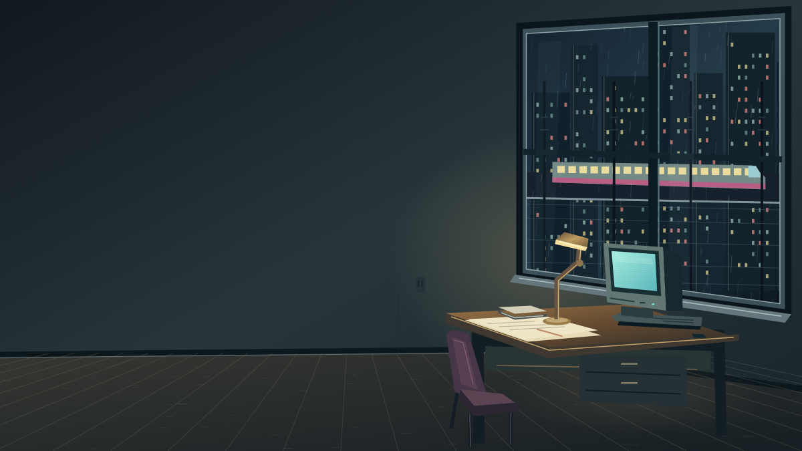
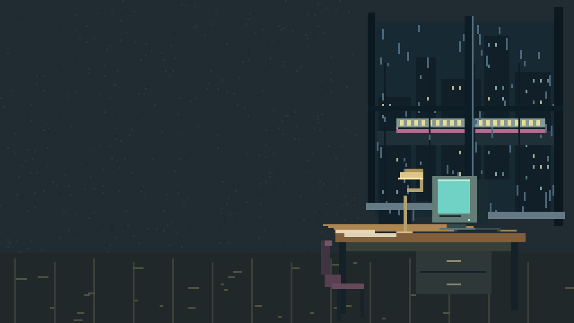

# Night Shift editable pilot — 12 October 2026

**Version 1 studies.** The owner found these below the requested pictorial quality bar. They are preserved unchanged for comparison; the targeted [quality study 02](quality-02/README.md) is the next visual checkpoint. Neither version is finished or production-accepted art.

Two original source alternatives: `night-shift-workshop.svg` (1600×900 native geometry, 14 named layers) and `night-shift-pixel.svg` (320×180 integer pixel geometry, 11 named layers). No embedded raster, external image, font dependency, tracing or GPU submission. Open `review.html` for static rendering and explicitly requested restrained motion. The SVG files contain no animation or script.

## Individual Chromium previews

These PNGs are rendered previews of the unchanged editable masters, not source substitutions or art acceptance.

The workshop retains the accepted MA's quiet left wall, right window, elevated train, cyan CRT and brass task light. It deliberately uses a cleaner illustrative finish; it does not reproduce the painted texture or claim pixel identity. The pixel study is a distinct low-resolution interpretation. Actual Chromium pixels were inspected at 390 and 1440 widths. Inspection found and corrected an opaque window occlusion and a hard light-pool edge. The pixel grid remains editable rectangles rather than a bitmap disguised as SVG.

The preserved accepted-MA sharpening sheet is linked for comparison. Full-resolution Library MA materialization is blocked: the current supplied transfer helper calls `os.setxattr`, unavailable in Windows Python. No helper patch, invented URL or stripped metadata workaround was used. Full-resolution original comparison remains a gate.

## Preserved inventory and scope

Live recovery: main `3578859a1769dac5b3e723cf670083bc8a812b26`; #1269 remains draft/unmerged/nonmergeable at `988e7c9636052e024073e1931f75268db916c9c9`. Its 97/154 source/design coverage and October 2 selection ledger remain authoritative. Workflow-create 3, reference-identity 3 and the 21 delegated choices are not reopened.

The remaining 57 catalogue IDs comprise ten actual tutorials, a real repair pair, the Night Shift loop, 44 explicit deferrals and dependent motion-parallax. Tutorial-reference already has its real 4.73-second clip after #1272. This pilot satisfies none of those execution/motion acceptance gates by implication.

No runtime activation, acceptance flag, licence decision, merge or deployment. Existing SVG/icon/component/motion kits still require their application-level qualification. Owner art/licensing and parallax/floor/look/Vary decisions in HUMAN_TODO.md remain unchanged. The new alternatives stay outside runtime pending visual selection and qualification.

Validation and final checkpoint evidence are reported in the draft PR; source XML/safety, browser rendering, motion lifecycle and artistic judgement are separate claims.
