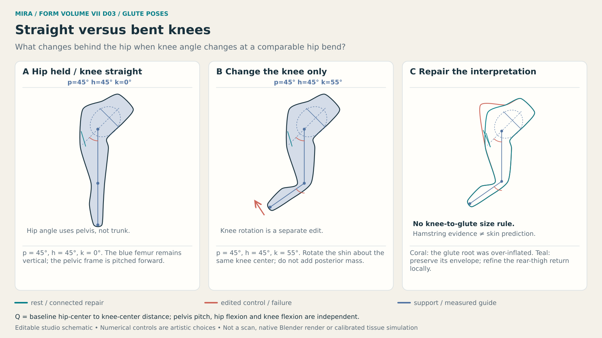
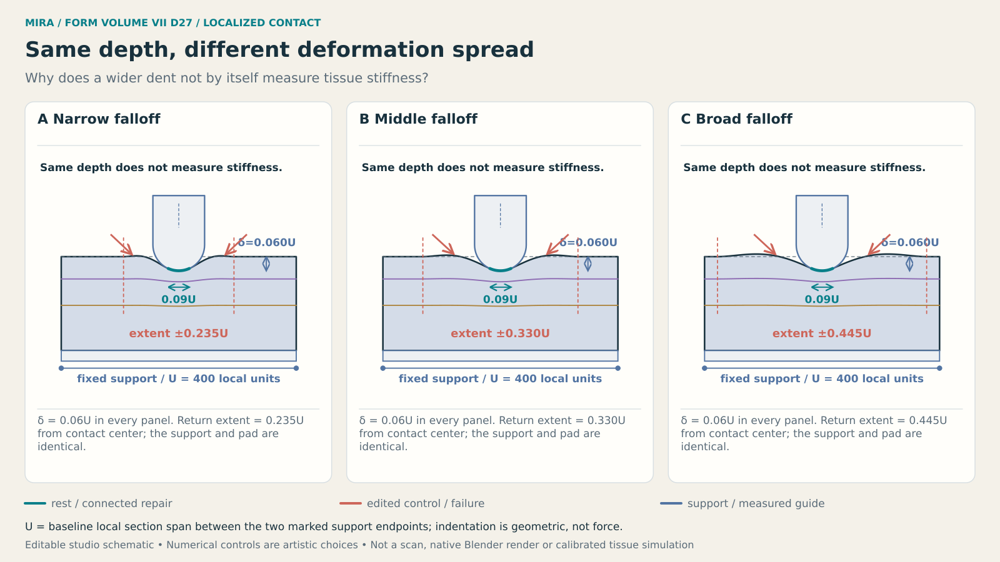
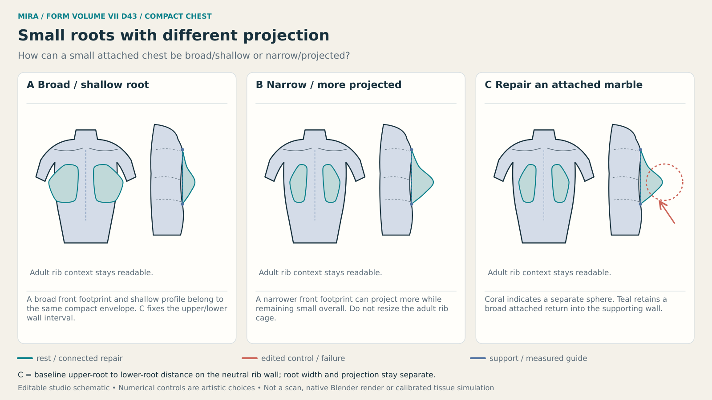

# MIRA / FORM VII — Pose, Contact & Compact Forms

A visual studio guide for shaping anonymous adult anime mannequins in Blender. Volume VII studies how pelvic orientation, hip and knee angles, local contact and compact proportions change the visible envelope. It continues the preserved MIRA / FORM course with close regional studies and editable native examples.

## Open the guide

| Download | Use it for |
| --- | --- |
| [Illustrated PDF](https://chatgpt.com/library?file_id=libfile_481b03f536388191a75b28657f0f1de5&account_id=personal) | 126 landscape pages, including the 48 instructional studies and native comparison appendix. |
| [Interactive reader](https://chatgpt.com/library?file_id=libfile_953e109adbe48191b0c74e7df645f71b&account_id=personal) | Study navigation, reference panels, authored diagrams, notes, source register and native downloads. |
| [Pose and contact desk](https://chatgpt.com/library?file_id=libfile_32c91237268881919e2fcc6d3df0ab5a&account_id=personal) | Compare exported native endpoints with a shared camera and inspect geometric differences. |
| [Complete editable archive](https://chatgpt.com/library?file_id=libfile_ee994af6821c8191b66528318f56119b&account_id=personal) | Full-resolution images, all 48 SVG diagrams, lesson/source data, the `.blend`, scripts and verification records. |

These are owner download links. The archive contains the complete deliverable; the small selection in this repository is a reviewable guide and source handoff.

Start with **D03** to separate hip and knee controls, **D27** to compare equal-depth contact fields, then **D43** to distinguish small root breadth from projection. Each lesson provides a visual goal, fixed and changing variables, construction diagram, concrete Blender actions, failure/repair example, exercise and observable pass criterion.

## Three useful comparisons

### Keep hip and knee changes separate

A knee change is a separate control from hip flexion and pelvic orientation. The diagram's angles and local units are explicit artistic construction choices. The source register and full lesson state which anatomical evidence supports the comparison.

### Hold contact depth while changing the field

The two loaded native fields use the same imposed depth and probe radius. Their spread is an authored shape parameter. A dent alone does not establish tissue stiffness or the force needed to make it. The desk keeps unloaded/loaded comparisons at their endpoints and allows continuous comparison between equal-depth local/broad fields.

### Small size still allows different forms

Root breadth, projection, fullness height and rib-wall context provide separate design choices. The presets are authored forms, not biological categories or attractiveness rankings.

## Open the Blender lab

Extract the complete archive and open `native/MIRA-FORM-Pose-Contact-Lab.blend` in Blender 5.4 alpha. Its executed build is **5.4.0 Alpha, commit 50d477803fa8**, built on 2026-11-03. The user's own installed application was not inspected.

In Blender's Text Editor, select **MIRA VII - Choose pose or contact.py** and run the complete text. The companion `native/README.md` explains case selection, form mixing, camera selection and independent joint controls. The lab contains ten scenes and 43 selectable cases, with 19 actual five-bone armatures and 74 newly rendered views.

The working examples are smooth triangulated sculpt constructions with supporting context. A full-character rig, production retopology, collision solve and material simulation are separate work.

## Read the evidence correctly

- **Generated reference sheets** are conceptual illustrations inspected by an agent for teaching defects and panel/caption agreement. Generation does not establish measured anatomy or owner art acceptance.
- **Authored SVGs** supply exact teaching geometry, local units, angle rays and cross-sections.
- **Native examples** are actual Blender constructions, evaluated endpoints and Cycles renders. The 48 lesson recipes are authored exercises; they are not claimed as 48 complete native executions.
- **Browser intermediates** interpolate exported coordinates. They do not run Blender's armature or a tissue solver.

Use [the study index](STUDIES.md) to choose a topic, [coverage and verification](COVERAGE.md) to assess what was completed, and [the source register](SOURCE-REGISTER.json) for the anatomical/software claim limits. [Release metadata](release.json) binds the artifact links and hashes.
